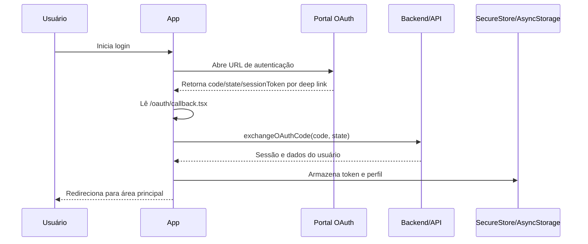

# Auditoria técnica e de segurança — Minhas Diárias

**Repositório auditado:** [JohnDev20/App-diaria](https://github.com/JohnDev20/App-diaria)  
**Artefato analisado:** APK descompilado `MinhasDirias_1.0.0_space.manus.minhas.diarias.app.t20260210200658.apk_Decompiler.com.zip`  
**Data da auditoria:** 17 de agosto de 2026  
**Branch do repositório:** `main`  
**Commit do repositório analisado:** `c227799`  
**Autor:** Manus AI

## 1. Escopo e conclusão executiva

Esta auditoria combinou a inspeção do conteúdo versionado do repositório com a análise estática do pacote Android descompilado fornecido. Foram examinados o manifesto Android, a configuração Expo embutida, classes Java de inicialização, nomes de rotas, strings do bundle JavaScript, permissões, serviços, receivers, providers, endpoints legíveis, indicadores de autenticação, artefatos de desenvolvimento, dependências do repositório e disponibilidade de ferramentas para testes dinâmicos.

A conclusão central é que **o APK e o repositório não representam o mesmo estado de produto**. O Git contém apenas um scaffold documental mínimo, enquanto o APK contém uma aplicação Expo/React Native compilada, com bundle JavaScript, módulos nativos, notificações, áudio, vídeo, autenticação OAuth, SecureStore/AsyncStorage, rotas Expo Router e configuração Android concreta. O APK não pode ser reproduzido pelo commit atual do repositório.

> **Classificação geral:** o APK é um artefato funcional em potencial, mas não foi possível comprovar seu comportamento em execução; o repositório está **incompleto, não reprodutível e desalinhado** com o artefato entregue.

| Área auditada | Resultado | Confiança |
|---|---|---:|
| Existência de aplicação compilada no APK | Confirmada por bundle, classes, manifesto e bibliotecas nativas | Alta |
| Correspondência entre APK e repositório | Não confirmada; há divergências críticas de nome, stack e entry point | Alta |
| Inicialização React Native/Expo | Evidenciada no código descompilado | Alta |
| Rotas de navegação | Nomes de rotas encontrados no bundle | Média/alta |
| Autenticação OAuth | Fluxo e mensagens encontrados no bundle | Média; requer teste dinâmico |
| Persistência de sessão | Referências a SecureStore e AsyncStorage encontradas | Média |
| Notificações | Serviços e receivers presentes no manifesto | Alta para suporte técnico; média para uso correto |
| Tarefas, diárias e calendário | Não confirmados de forma inequívoca pela análise estática | Baixa |
| Ausência de falhas em execução | Não verificável; não havia dispositivo/emulador | Nula |
| Segurança de dependências do repositório | Fraca; base antiga e 34 vulnerabilidades no grafo resolvido | Alta |
| Reprodutibilidade do APK pelo Git | Não é possível com o estado atual | Alta |

## 2. Metodologia e limitações

A análise do repositório foi feita na branch `main`, no commit `c227799`, utilizando o histórico Git, a árvore de arquivos e os manifestos de dependência. A análise do APK foi feita sobre o ZIP descompilado anexado pelo usuário. O ZIP possui 13.391 arquivos e 1.449 diretórios, incluindo recursos, classes Java decompiladas, bibliotecas nativas, bundle JavaScript e manifesto.

Foram usados procedimentos passivos: leitura de arquivos, inventário, busca de strings, análise de permissões, identificação de componentes Android, comparação de hashes e execução dos scripts declarados no repositório. Nenhum código descompilado ou binário desconhecido foi executado.

Não havia `adb`, `aapt`, `apkanalyzer`, `apktool` ou `jadx` disponíveis no ambiente, nem havia dispositivo Android ou emulador conectado. Por essa razão, esta auditoria **não confirma** instalação, login, navegação, permissões em tempo de execução, notificações, deep links, crashes, comportamento offline, consumo de bateria, acessibilidade ou vazamento de dados em tráfego. Os itens classificados como “erro” ou “falha” abaixo são defeitos verificáveis no repositório, riscos derivados da configuração ou mensagens de erro presentes no bundle; não devem ser interpretados como uma reprodução dinâmica de crash.

## 3. Inventário do repositório

O repositório contém somente `.gitignore`, `README.md` e `package.json` no commit original. O relatório e a pasta `auditoria_apk/` serão adicionados por este commit de auditoria. Não existem arquivos de entrada, telas, componentes, serviços, testes ou projetos nativos no estado original.[1] [2]

| Elemento esperado em um app React Native/Expo | Estado no repositório original | Consequência |
|---|---|---|
| `App.js`, `index.js` ou entry point equivalente | Ausente | Não há ponto de inicialização versionado. |
| `src/`, telas e componentes | Ausente | Não há implementação de interface ou fluxo. |
| Navegação | Ausente | O README cita seções, mas não há rotas. |
| Persistência | Ausente | Não há banco local, AsyncStorage, SecureStore ou API declarada. |
| Notificações | Ausente | Não há agendamento, permissões ou receivers. |
| Calendário | Ausente | Não há integração com calendário. |
| Android/iOS nativos | Ausente | O projeto não contém estrutura para gerar os aplicativos. |
| Testes | Ausente | O script existe, mas nenhum teste é encontrado. |
| Lockfile | Ausente | As versões transitivas não são reproduzíveis. |
| Licença referenciada pelo README | `LICENSE.md` ausente | A documentação aponta para um arquivo inexistente. |

O `README.md` descreve gerenciamento de tarefas, lembretes, integração com calendário, perfis e notificações, além de mencionar uma aplicação criada com Natively. Essas funcionalidades são requisitos documentados, não evidências de implementação.[2]

O `package.json` declara React `^17.0.2`, React Native `^0.66.0`, Jest `^27.0.6` e `babel-jest` `^27.0.6`. Os scripts são `start`, `build` e `test`, mas o manifesto não declara Expo, Expo Router, bibliotecas de calendário, notificações, armazenamento, autenticação ou navegação.[1]

## 4. Verificações de execução e qualidade do repositório

A instalação com `npm install --ignore-scripts --no-audit --no-fund` foi concluída, mas isso apenas confirma que o manifesto pôde resolver dependências. A execução de `npm test -- --runInBand` falhou com **“No tests found”**. A versão do CLI React Native instalada localmente foi reportada como `6.4.0`, mas isso não valida o aplicativo, pois o repositório não contém código de entrada nem estrutura nativa.

| Verificação | Resultado | Falha ou interpretação |
|---|---|---|
| Instalação de dependências | Concluída | O manifesto é resolvível, mas não há lockfile. |
| `npm test -- --runInBand` | Falhou | Não existem testes no repositório. |
| `npm run start` | Não validado como app | Não há entry point ou estrutura funcional. |
| `npm run build` | Não validado como build | Não há Android/iOS nem código de produto. |
| Auditoria de dependências | 34 vulnerabilidades | 9 baixas, 10 moderadas, 13 altas e 2 críticas no grafo resolvido. |
| CI/CD | Ausente | Não há workflow versionado ou critério automatizado de qualidade. |

A auditoria do grafo instalado identificou alertas envolvendo `react-native`, `hermes-engine`, Metro, React Native CLI, `image-size`, `ip`, `ws`, `micromatch`, `uuid`, Jest e dependências relacionadas. Como o lockfile não está versionado, os números podem mudar em uma nova instalação; ainda assim, o resultado evidencia uma base de manutenção inadequada para produção.

## 5. Inventário técnico do APK

O APK possui o package ID `space.manus.minhas.diarias.app.t20260210200658`, nome de produto **Minhas Diárias**, versão `1.0.0`, `versionCode` `10000`, `minSdkVersion` 24, `targetSdkVersion` 36 e `compileSdkVersion` 36.[5] [6] [7]

O `BuildConfig` indica build `release`, `DEBUG=false`, Hermes habilitado, nova arquitetura habilitada e nível de release estável. O bundle JavaScript `resources/assets/index.android.bundle` possui 2.906.512 bytes. O pacote inclui bibliotecas React Native, Hermes, Reanimated, Worklets, SVG, Screens, Expo Modules e outros componentes nativos.[7]

A configuração Expo embutida informa Expo SDK `54.0.0`, Expo Router, orientação retrato, suporte a iOS/Android/web, `newArchEnabled`, deep link com esquema `manus20260210200658` e plugins `expo-audio`, `expo-video`, `expo-splash-screen` e `expo-build-properties`.[5]

| Evidência | O que demonstra | Limite da evidência |
|---|---|---|
| `app.config` | Identidade, SDK, plugins, permissões de configuração e deep link | Não demonstra que cada plugin é usado em uma tela funcional. |
| `AndroidManifest.xml` | Componentes e permissões efetivamente empacotados | Algumas permissões vêm transitivamente de bibliotecas. |
| `MainActivity.java` | Atividade principal React Native, splash, componente `main` e deep link | É código de bootstrap descompilado. |
| `MainApplication.java` | Entry point Expo Router, Hermes, nova arquitetura e lifecycle | Não contém a lógica de negócio. |
| `BuildConfig.java` | Versão, modo release, Hermes e arquitetura | Não demonstra estabilidade ou ausência de bugs. |
| Bundle JavaScript | Rotas, mensagens e integrações legíveis | O bundle está compilado, sem source map entregue. |

## 6. Arquitetura observada

A arquitetura empacotada aparenta ser Expo Router sobre React Native moderno. O fluxo de bootstrap parte da atividade Android, passa pelo splash screen, instancia o host React Native, carrega o entry point virtual do Expo e registra o componente principal `main`. A nova arquitetura e Hermes estão habilitados.[7] [8] [9]

```mermaid
flowchart TD
    A[Android Launcher] --> B[MainActivity]
    B --> C[SplashScreenManager]
    C --> D[MainApplication / ReactNativeHost]
    D --> E[.expo/.virtual-metro-entry]
    E --> F[Expo Router]
    F --> G[(tabs)/index.tsx]
    F --> H[(tabs)/summary.tsx]
    F --> I[(tabs)/settings.tsx]
    F --> J[oauth/callback.tsx]
    D --> K[Hermes + New Architecture]
    D --> L[Expo native modules]
```

O código próprio descompilado encontrado no pacote é essencialmente bootstrap: `MainActivity`, `MainApplication`, `BuildConfig` e `R`. Não foram encontrados arquivos Java próprios de domínio para tarefas, calendário ou perfis. A lógica de negócio está no bundle JavaScript compilado, que não possui código-fonte ou source map correspondente no repositório.

## 7. Fluxos funcionais inferidos

### 7.1 Fluxo de inicialização

O fluxo de inicialização observado é: lançamento pelo Android; abertura da `MainActivity`; registro do splash screen; criação da aplicação React Native; carregamento do entry point virtual Expo; inicialização do Expo Router; e renderização das rotas. A atividade usa `singleTask`, orientação retrato, `adjustResize` para o teclado e suporta Picture-in-Picture.[6] [8] [9]

Esse fluxo é **evidenciado estaticamente**, mas não foi executado. Os riscos associados são falha de inicialização do bundle, incompatibilidade de versão entre JavaScript e módulos nativos, erro de splash screen, falha do host React Native ou rota inexistente.

### 7.2 Fluxo de autenticação OAuth

O bundle contém uma rota `./oauth/callback.tsx` e referências a `initializeCore_startOAuthLogin`, `exchangeOAuthCode`, `establishSession`, `get-app_session_token`, `sessionToken`, `OAuth`, SecureStore e AsyncStorage. O fluxo provável é o seguinte:



As mensagens presentes no bundle incluem `No session token received`, `Authentication successful!`, `Session token stored successfully`, `Session token retrieved from SecureStore`, `Failed to set session token`, `Failed to get session token`, `Failed to remove session token`, `Failed to clear user info`, `OAuth exchange result`, `OAuth exchange failed`, `Request failed` e `establishSession failed`. Isso demonstra que o fluxo possui caminhos de erro previstos, mas não confirma que o tratamento seja seguro ou que a interface informe adequadamente o usuário.

**Falhas que precisam de teste:** retorno sem `code`; retorno sem `state`; `sessionToken` ausente; código expirado; troca OAuth com HTTP 4xx/5xx; token inválido; SecureStore indisponível; AsyncStorage corrompido; logout incompleto; sessão expirada; rede indisponível; retorno por callback duplicado; e redirecionamento para rota inexistente.

### 7.3 Fluxo de navegação

O bundle revela `./_layout.tsx`, `./(tabs)/_layout.tsx`, `./(tabs)/index.tsx`, `./(tabs)/summary.tsx`, `./(tabs)/settings.tsx` e `./oauth/callback.tsx`.[11] A existência dos nomes indica uma navegação baseada em layout raiz, abas, tela inicial, resumo, configurações e callback OAuth.

Não foi possível confirmar quais componentes visuais existem em cada tela, quais ações persistem dados ou se a tela inicial representa tarefas/diárias. A presença de `summary` e `settings` não comprova a presença de calendário, CRUD de tarefas ou perfil de usuário.

**Falhas possíveis:** rota de fallback `Unmatched`, retorno após login sem tela válida, parâmetros inválidos em deep link, estado de aba perdido após reinicialização, telas duplicadas, erro de ícone de aba e inconsistências de layout. O bundle contém mensagens como `No route named`, `indexedSetNew tab route is missing`, `Too many screens defined`, `Invalid route` e referências a `Unmatched.jsx`, que devem ser tratadas como indicadores de caminhos de erro do framework, não como crashes reproduzidos.

### 7.4 Fluxo de notificações

O manifesto registra `POST_NOTIFICATIONS`, Firebase Cloud Messaging, `ExpoFirebaseMessagingService`, `FirebaseMessagingService`, `NotificationsService` e receivers para eventos de notificação, reinicialização do dispositivo, substituição do pacote e boot completo.[6] Isso indica suporte técnico a notificações remotas e eventos persistentes.

O README do repositório descreve lembretes, mas não existe código versionado que mostre agendamento local, associação de notificação a uma diária ou restauração de alarmes. O APK contém a infraestrutura, mas não confirma, estaticamente, que o usuário consiga criar ou editar lembretes.

**Falhas que precisam de teste:** permissão negada; Android 13 ou superior sem `POST_NOTIFICATIONS`; token FCM ausente; app encerrado; aparelho reiniciado; fuso horário alterado; horário de verão; lembrete recorrente; notificação duplicada; cancelamento de lembrete; ação ao tocar na notificação; e restauração após atualização do aplicativo.

### 7.5 Fluxo de áudio, vídeo e gravação

A configuração e o manifesto incluem `expo-audio`, `expo-video`, `AudioControlsService`, `AudioRecordingService`, `ExpoVideoPlaybackService`, foreground service de mídia, Picture-in-Picture, `RECORD_AUDIO` e `MODIFY_AUDIO_SETTINGS`.[5] [6] O APK contém uma superfície de mídia muito maior do que a descrita no README.

Não foi encontrada confirmação de que áudio ou vídeo sejam parte do produto de diárias. Se esses módulos forem residuais, representam peso, consumo de bateria, permissões e superfície de ataque desnecessários. Se forem intencionais, faltam documentação, testes de ciclo de vida e justificativa de produto no repositório.

**Falhas que precisam de teste:** permissão de microfone negada; interrupção por chamada; reprodução em segundo plano; Picture-in-Picture; serviço em foreground; pausa após app ser removido dos recentes; perda de foco de áudio; rotação; consumo de bateria; e comportamento em Android 12–15.

### 7.6 Fluxo de deep link

O manifesto registra o esquema `manus20260210200658`, filtros `VIEW`, categoria `BROWSABLE`, `DEFAULT`, `autoVerify=true` e host curinga. A configuração Expo também registra um intent filter com o mesmo esquema.[5] [6]

O fluxo provável é: sistema Android recebe um URI; abre a `MainActivity`; o React Native/Expo Router interpreta a URL; o callback OAuth extrai `code`, `state` ou `sessionToken`; a sessão é estabelecida; e o app redireciona para a tela principal.

**Falhas e riscos:** esquema previsível; host curinga; parâmetros sem validação; callback duplicado; ausência de `state` ou validação fraca contra CSRF; rota inválida; abertura por aplicativo malicioso; token exposto em logs ou histórico de URL; e tratamento incompleto de erro. A análise estática não prova que essas falhas existam, mas o fluxo exige testes específicos.

## 8. Erros e falhas identificados

Esta seção separa defeitos confirmados do repositório, falhas de rastreabilidade, riscos do APK e mensagens de erro que precisam de validação dinâmica.

### 8.1 Defeitos confirmados no repositório

| ID | Defeito | Severidade | Evidência | Impacto |
|---|---|---:|---|---|
| REPO-001 | O repositório não contém o código do app descrito | Crítica | Somente três arquivos no commit original | Não é possível corrigir, compilar ou reproduzir o produto. |
| REPO-002 | APK e Git usam identidades diferentes | Crítica | “App Diaria” no README versus “Minhas Diárias” no APK | Releases podem estar sendo geradas de outro projeto. |
| REPO-003 | Stack declarada diverge da stack do APK | Crítica | React Native 0.66 no `package.json` versus Expo SDK 54 no APK | O Git não representa a origem do binário. |
| REPO-004 | Entry point ausente | Crítica | Não há `App.js`, `index.js` ou equivalente | Scripts não têm uma aplicação para iniciar. |
| REPO-005 | Testes ausentes | Alta | `npm test` retorna `No tests found` | Não há proteção contra regressão. |
| REPO-006 | Lockfile ausente | Alta | Nenhum `package-lock.json` ou `yarn.lock` | Builds podem receber dependências diferentes. |
| REPO-007 | Licença referenciada, mas não versionada | Média | README cita `LICENSE.md`, arquivo ausente | Incerteza jurídica e de distribuição. |
| REPO-008 | Dependências antigas e vulneráveis | Alta | Auditoria local com 34 alertas | A cadeia de build tem risco conhecido. |
| REPO-009 | Scripts de build não comprovados | Alta | Sem projeto nativo ou código | Não há garantia de APK gerável pelo Git. |

### 8.2 Riscos e falhas potenciais no APK

| ID | Risco/falha | Severidade | Evidência | Teste recomendado |
|---|---|---:|---|---|
| APK-001 | Código-fonte correspondente não está no Git | Crítica | Bundle e bootstrap existem apenas no APK | Associar APK a commit e obter projeto original. |
| APK-002 | `allowBackup=true` pode expor dados locais | Alta | Manifesto | Testar backup/restauração e conteúdo de armazenamento. |
| APK-003 | Permissões excessivas ou não justificadas | Alta | Microfone, overlay, storage, boot, wake lock e mídia | Mapear cada permissão para uma ação de negócio. |
| APK-004 | Deep link com host curinga | Alta | Manifesto/configuração Expo | Validar domínio, `state`, origem e parâmetros. |
| APK-005 | OAuth sem teste de todos os caminhos de erro | Alta | Strings e funções no bundle | Testar token ausente, código expirado, rede e logout. |
| APK-006 | Serviços de mídia podem ser residuais | Média/alta | Expo Audio/Video e serviços foreground | Confirmar uso; remover módulos não utilizados. |
| APK-007 | Notificações não comprovadas funcionalmente | Alta | Infraestrutura FCM/receiver presente | Testar agendamento, reboot, permissão e toque. |
| APK-008 | Source map e fonte original ausentes | Alta | Apenas bundle e Java decompilado | Entregar fontes, mapas e lockfile do release. |
| APK-009 | Possível exposição de dados em logs | Média | Strings de sessão/OAuth no bundle | Testar logcat e remover token de logs. |
| APK-010 | Endpoint de runtime não rastreado pelo Git | Alta | Domínio/strings no bundle | Documentar ambiente, API, versão e contrato. |
| APK-011 | Falhas de offline e sessão não testadas | Alta | Mensagens de rede/auth no bundle | Testar sem rede, reconexão e sessão expirada. |
| APK-012 | Consumo de bateria em background | Média/alta | Foreground service, wake lock, boot receiver | Medir bateria e limitar tarefas de background. |

As mensagens `Network request failed`, `Request failed`, `No session token received`, `OAuth exchange failed`, `establishSession failed`, `Failed to get session token`, `Failed to set session token` e `Failed to clear user info` demonstram que existem caminhos de falha no código compilado. O relatório não afirma que todos são bugs: eles são **pontos de teste obrigatórios** porque não foi possível avaliar a resposta da interface, o retry, a limpeza de estado ou a segurança dos logs.

## 9. Auditoria de segurança

### 9.1 Permissões sensíveis

O manifesto declara internet, notificações, vibração, microfone, alteração de áudio, armazenamento, janela sobreposta, boot completo, wake lock, serviços em primeiro plano, biometria, Firebase Cloud Messaging e permissões de badges de diversos fabricantes.[6]

| Permissão/capacidade | Justificativa possível | Risco se não for necessária |
|---|---|---|
| `RECORD_AUDIO` | Gravação de áudio | Privacidade e consentimento. |
| `SYSTEM_ALERT_WINDOW` | Janela sobreposta | Alto impacto e abuso potencial. |
| `WRITE_EXTERNAL_STORAGE` | Exportação/compartilhamento de arquivos | Acesso a dados e compatibilidade em versões atuais. |
| `RECEIVE_BOOT_COMPLETED` | Restaurar notificações/agendamentos | Execução após boot e consumo de bateria. |
| `WAKE_LOCK` | Executar trabalho em segundo plano | Consumo elevado de bateria. |
| Foreground service | Reprodução ou gravação | Notificação persistente e consumo de recursos. |
| `POST_NOTIFICATIONS` | Alertas e lembretes | Falha silenciosa se permissão for negada. |
| Biometria | Desbloqueio ou proteção de sessão | Exige UX, fallback e política de dados. |

A presença de uma permissão não prova que ela seja solicitada em tempo de execução. O princípio recomendado é remover toda permissão não essencial, solicitar acesso no momento da ação correspondente, explicar a finalidade e registrar o comportamento quando o usuário recusar.

### 9.2 Autenticação e armazenamento

Há referências a SecureStore e AsyncStorage, e o bundle contém mensagens de armazenamento e remoção de sessão. SecureStore é adequado para material sensível em determinadas configurações, mas a auditoria não pode confirmar o algoritmo, a política de expiração, a proteção contra replay, a limpeza após logout ou o tratamento de backup.

O uso concomitante de AsyncStorage para informações de usuário deve ser revisado. Tokens, códigos OAuth, dados pessoais e credenciais não devem ser gravados em armazenamento não seguro. Também é necessário verificar se mensagens de depuração imprimem tokens, respostas de OAuth ou dados de usuário no logcat.

### 9.3 Deep links e OAuth

A combinação de deep link, callback OAuth e parâmetros `code`, `state` e `sessionToken` é um ponto de alto risco. O aplicativo deve validar `state` contra um valor gerado antes do login, aceitar somente redirecionamentos esperados, rejeitar esquemas ou hosts não autorizados, evitar colocar tokens em URLs e impedir que um callback antigo seja reutilizado.

O APK contém referências a um callback em `classic-assets.eascdn.net` e a um domínio de runtime `minhasdiarias-khvggodn.manus.space.manus.minhas.diarias.app.t20260210200658`. Como strings compiladas podem ser concatenadas ou herdadas de bibliotecas, esses valores precisam ser confirmados no código-fonte e na configuração de ambiente antes de serem tratados como endpoints oficiais.

### 9.4 Backup, arquivos e compartilhamento

`android:allowBackup="true"` está ativo. Se tarefas, perfis, tokens ou preferências forem armazenados localmente, deve ser definido se o backup é aceitável. Providers de clipboard, filesystem e sharing estão registrados. O produto deve garantir que arquivos compartilhados usem URIs temporárias, permissões mínimas e limpeza de arquivos temporários.

## 10. Auditoria de qualidade e manutenção

A qualidade do repositório é insuficiente para manutenção profissional: não há fonte de verdade para o APK, não há testes, não há lockfile, não há CI, não há política de versionamento, não há instrução de release verificável e não há documentação das permissões. O APK demonstra que existe um projeto mais avançado, mas esse projeto não está conectado ao repositório analisado.

O bundle inclui dependências modernas como Expo Router, Reanimated, Worklets e módulos de áudio/vídeo. O repositório declara versões antigas e incompatíveis. A atualização direta do `package.json` para refletir o APK não seria suficiente; é necessário recuperar o projeto Expo original, seus assets, configurações, plugins, lockfile, variáveis de ambiente, configuração de build e código-fonte.

A ausência de source map limita a análise de lógica, nomes de funções e telas. A descompilação Java também produz classes de bootstrap, não o código original Kotlin/Java. O pacote descompilado deve ser tratado como evidência forense, não como fonte de manutenção.

## 11. Matriz de testes recomendada

| Fluxo | Cenário positivo | Cenários negativos obrigatórios | Resultado atual |
|---|---|---|---|
| Inicialização | Abrir app e chegar à tela inicial | Bundle ausente, módulo incompatível, rotação, cold start | Não executado |
| OAuth | Login, callback e sessão persistida | `code` ausente, `state` inválido, timeout, 401, cancelamento | Não executado |
| Logout | Remover token e dados de usuário | SecureStore indisponível, falha parcial, reabertura do app | Não executado |
| Navegação | Abrir abas, resumo e configurações | Rota inexistente, back, deep link inválido, tela duplicada | Não executado |
| Tarefas/diárias | Criar, editar, concluir e excluir | Campos vazios, duplicidade, fuso, offline, reinicialização | Não confirmado no APK |
| Lembretes | Criar, receber e cancelar | Permissão negada, reboot, horário de verão, recorrência | Não confirmado no APK |
| Notificações | FCM/local notification e toque | Token ausente, app encerrado, canal inexistente | Não executado |
| Calendário | Permitir e sincronizar | Permissão negada, evento duplicado, fuso, calendário ausente | Não confirmado no APK |
| Áudio/vídeo | Iniciar, pausar, background e PiP | Interrupção, microfone negado, bateria, saída dos recentes | Não executado |
| Deep link | Abrir rota autorizada | Host curinga, parâmetros malformados, callback duplicado | Não executado |
| Segurança | Backup e armazenamento protegidos | Extração de dados, logs, tráfego, replay | Não executado |

## 12. Plano de correção priorizado

### P0 — bloquear releases até reconciliar a fonte

O time deve identificar o projeto que originou o APK e associá-lo ao repositório correto. O repositório deve receber o código Expo/React Native correspondente, `app.config`, assets, lockfile, configuração de build, rotas, serviços, variáveis de ambiente documentadas sem segredos e um vínculo entre cada versão do APK e um commit.

Também é necessário decidir se `App Diaria` e `Minhas Diárias` são o mesmo produto. Se forem, a identidade, package ID, nome, README e histórico precisam ser reconciliados. Se não forem, o APK deve ser associado a outro repositório para evitar alterações no projeto errado.

### P1 — corrigir segurança e reprodutibilidade

Revisar `allowBackup`, permissões, deep links, armazenamento de sessão, logs de autenticação, providers de arquivos e serviços em background. Remover módulos de áudio/vídeo, permissões e receivers que não tenham requisito funcional. Fixar dependências com lockfile, atualizar a base, executar auditoria no CI e documentar os resultados.

### P1 — criar teste funcional e automatizado

Instalar o APK em dispositivo/emulador Android suportado e executar a matriz da seção 11. Registrar logs sem tokens, crashes, respostas HTTP, permissões, comportamento de notificação, consumo de bateria e restauração após reboot. Em seguida, converter os casos críticos em testes automatizados e testes de integração.

### P2 — melhorar documentação e operação

Atualizar o README com arquitetura real, requisitos, comandos de build, ambientes, permissões, política de privacidade, fluxo OAuth, estratégia de dados, versão mínima do Android, procedimento de release e contato de manutenção. Adicionar CI com lint, testes, auditoria, validação de configuração e geração rastreável do APK.

## 13. Arquivos versionados neste commit

Este commit adiciona o relatório e a pasta `auditoria_apk/`, que contém evidências textuais selecionadas: manifesto, configuração Expo, classes Java de bootstrap, inventário de rotas, strings relevantes e hashes. O APK/ZIP completo não foi copiado para o Git por ser um artefato binário grande; ele permanece como anexo original da auditoria.

Os arquivos Java da pasta `auditoria_apk/` são saídas decompiladas e não devem ser usados como código-fonte de produção. O inventário de strings pode conter ruído de bibliotecas e concatenações do bundle.

## 14. Referências

[1]: https://github.com/JohnDev20/App-diaria/blob/main/package.json "Manifesto de dependências e scripts do repositório"

[2]: https://github.com/JohnDev20/App-diaria/blob/main/README.md "Documentação original do App Diária"

[3]: https://github.com/JohnDev20/App-diaria/commits/main "Histórico da branch main"

[4]: https://github.com/JohnDev20/App-diaria "Repositório GitHub auditado"

[5]: ./auditoria_apk/app.config "Configuração Expo extraída do APK"

[6]: ./auditoria_apk/AndroidManifest.xml "Manifesto Android extraído do APK"

[7]: ./auditoria_apk/BuildConfig.java "BuildConfig extraído do APK"

[8]: ./auditoria_apk/MainApplication.java "MainApplication decompilada do APK"

[9]: ./auditoria_apk/MainActivity.java "MainActivity decompilada do APK"

[10]: ./auditoria_apk/bundle_audit_strings.txt "Inventário de strings do bundle JavaScript"

[11]: ./auditoria_apk/app_routes.txt "Inventário de rotas e identificadores do bundle"

[12]: ./auditoria_apk/SHA256SUMS.txt "Hashes dos artefatos analisados"

> **Nota final:** esta é uma auditoria estática e comparativa. A confirmação de crashes, falhas de fluxo, comportamento de permissões e segurança efetiva exige executar o APK em um dispositivo ou emulador, com acesso ao código-fonte original e aos ambientes de backend correspondentes.
